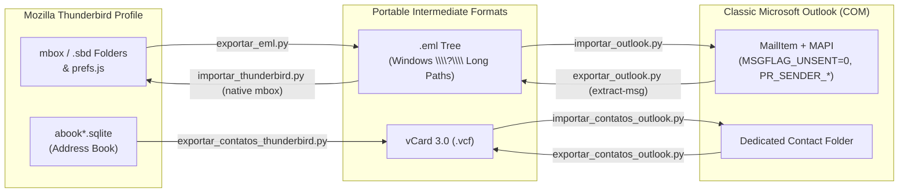

**🇺🇸 English** | [🇧🇷 Português](README.pt-BR.md)

# Thunderbird ⇄ Outlook

[](https://github.com/gavicoding/Thunderbird-Outlook/actions/workflows/ci.yml)
[](https://www.python.org/downloads/)
[](https://www.microsoft.com/windows)
[](LICENSE)

Bidirectional desktop & CLI utility to migrate **emails** and **address books (contacts)** between **Mozilla Thunderbird** and **Classic Microsoft Outlook** on Windows — preserving folder hierarchy, original received timestamps, sender headers, attachments, and embedded inline images.

---

## Key Capabilities

- **Two-Way Email Migration**:
  - **Thunderbird → Outlook**: Exports all Thunderbird accounts, Inbox, Sent, IMAP caches, and Local Folders into standard `.eml` trees, then imports them into Classic Outlook via COM automation.
  - **Outlook → Thunderbird**: Extracts Classic Outlook folders via COM (`.msg` → `.eml` via `extract-msg`) and writes native Thunderbird `mbox` + `.sbd` subfolder trees directly into `Mail/Local Folders`.
- **Two-Step or One-Click Modes**:
  - Run export & import together on the same workstation, or export on Machine A, copy the generated folder to removable media/network share, and import on Machine B.
- **Metadata & Edge-Case Fidelity**:
  - Resolves real email account names from Thunderbird's `prefs.js` (avoiding `mail.domain.com` vs `mail.domain.com-1` collisions).
  - Uses Windows long-path `\\?\` prefixes to bypass the 260-character `MAX_PATH` limit on deeply nested mail folders.
  - Clears `MSGFLAG_UNSENT` via MAPI `PropertyAccessor` and sets `PR_SENDER_*` properties so imported Outlook emails retain their **original received dates and senders** rather than appearing as newly received drafts.
  - Non-destructive imports: places migrated emails and contacts into dedicated folders without overwriting existing mailboxes.
- **Optional Contacts Migration (vCard 3.0)**:
  - Reads Thunderbird's `abook.sqlite` / `abook-N.sqlite` in read-only mode with defensive schema checks (`sqlite3` stdlib) and exchanges contacts via RFC 2426 vCard 3.0 (`.vcf`).

---

## Architecture & Data Flow



---

## Quick Start

### Option 1: Standalone Windows Executable (`MigrarThunderbirdOutlook.exe`)
Package or run the Tkinter/ttkbootstrap GUI (`migrar_app.py`), which automatically detects local Thunderbird profiles and Classic Outlook installations. No Python installation is required for end users when compiled via `MigrarThunderbirdOutlook.spec` (PyInstaller).

### Option 2: Run from Source (Windows)

```bash
pip install -r requirements.txt
python migrar_app.py
```

---

## CLI Modules Breakdown

| Module | Direction | Dependencies | What It Does |
| :--- | :--- | :--- | :--- |
| `exportar_eml.py` | Thunderbird → `.eml` | Stdlib only | Walks profiles, maps accounts via `prefs.js`, exports `.eml` with `\\?\` long-path support |
| `importar_outlook.py` | `.eml` → Outlook | `pywin32` | Rebuilds Outlook `MailItem`s via COM, clears `MSGFLAG_UNSENT`, preserves dates & senders |
| `exportar_outlook.py` | Outlook → mbox | `pywin32`, `extract-msg` | Exports Outlook items as `.msg` and converts to RFC-compliant `.eml`/mbox |
| `importar_thunderbird.py` | mbox → Thunderbird | Stdlib only | Copies native `mbox` + `.sbd` tree into `Mail/Local Folders/Importado do Outlook` |
| `exportar_contatos_thunderbird.py` | Thunderbird → `.vcf` | `sqlite3` (stdlib) | Read-only extraction from `abook*.sqlite` with defensive schema detection |
| `importar_contatos_outlook.py` | `.vcf` → Outlook | `pywin32` | Creates Outlook contacts in a dedicated folder via COM |
| `exportar_contatos_outlook.py` | Outlook → `.vcf` | `pywin32` | Generates per-account `.vcf` files for safe import via Thunderbird UI |
| `vcard_util.py` | Shared | Stdlib only | RFC 2426 vCard 3.0 serializer, parser, escaping, and line-unfolding |

---

## Outlook Compatibility

Works with **Classic Microsoft Outlook** (`2010`, `2013`, `2016`, `2019`, `2021`, and Microsoft 365 Classic desktop client) via COM automation. Not compatible with the web-based **"New Outlook"** app, which does not expose COM automation APIs.

---

## Disclaimer

This tool reads from and writes directly to Thunderbird and Outlook profiles. Always create a backup of your mail profiles before running any migration. Provided "AS IS", without warranty of any kind. See [LICENSE](LICENSE) for full details.
